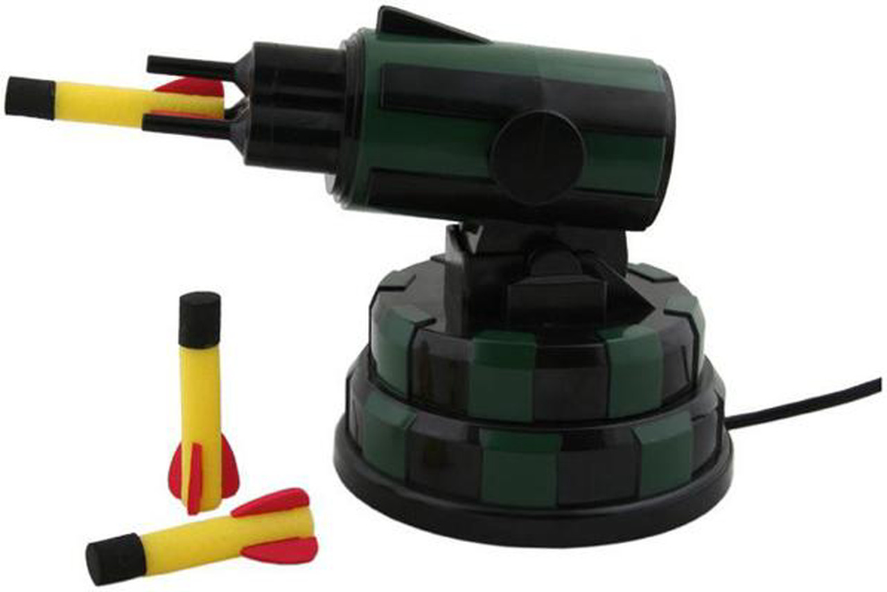

I had fun today attending Software Freedom Day in Jacksonville. SFD is a mini-conference held each year to show and inspire people about the advantages of Open Source Software. There were a number of great talks that included LibreOffice and 3D printing. I gave a presentation on JavaScript and Open Source Software.

For the part of my presentation that had a demo, I decided to do something neat for the audience, and I built a Node.js application that can control a Dream Cheeky USB Missile Launcher. If you are not familiar with Dream Cheeky, they were a Hong Kong based manufacturer of USB desk toys that could connect to a USB-A connector. These were neat desk toys back about 20 years ago, but the company no longer exists.



When they sold their USB missile launchers they came with software that ran on the Mac and Windows. The software has become hard to find, and will not run on a modern Mac. The Macintosh has gone through two processor architectures since the toy was launched.

Earlier this year I created a [Mac app](https://github.com/davidfekke/missileUSB) written in SwiftUI that can control the USB Missile Launcher. The toy is actually an HID device. Most platforms support controlling these devices. It is the same interface used by devices like your keyboard. Once I reverse engineered the byte codes for moving the launcher and firing the missiles, I was able to create an app.

For this years conference, I decided to write this as a command line utility that could run on Node.js. Node also has an HID interface and module that you can use to control HID devices.

```typescript
import HID from "node-hid";
```

## Installing the command line app

To install this app, you can use the following commands if you have Node.js and git installed on your computer:

```sh
git clone https://github.com/davidfekke/jsmissile.git
cd jsmissile
npm install
```

Once the app is installed, you use the `npm start` command, and use the arrow keys to move the missile launcher up and down, and left and right. Hit the spacebar to fire your missiles.

## The Code

For my SwiftUI app I have a class called AirCannon. I created a TypeScript factory function for creating an object that does the same functionality as the AirCannon class. I also created interfaces in TypeScript for this object.

```typescript
export interface AirCannon {
  readonly isConnected: boolean;
  readonly isFiringInProgress: boolean;
  getStatus(): Uint8Array;
  isLimitReached(direction: CannonDirection): boolean;
  stop(): void;
  up(): void;
  down(): void;
  left(): void;
  right(): void;
  fire(): void;
  startMoving(direction: CannonDirection): void;
  stopMoving(): void;
  moveSmart(direction: CannonDirection, durationMs: number): Promise<void>;
  fireAndWait(): Promise<void>;
  close(): void;
  on(event: "error", listener: (error: Error) => void): void;
  on(event: "status", listener: (status: Uint8Array) => void): void;
  on(event: "connected", listener: () => void): void;
  on(event: "limit", listener: (direction: CannonDirection) => void): void;
  on(event: "fired", listener: () => void): void;
}
```

Rather than use the EventEmitter API, I opted to use a function that could mimic all of the events needed by the AirCannon object.

```typescript

interface CannonEvents {
  error: (error: Error) => void;
  status: (status: Uint8Array) => void;
  connected: () => void;
  limit: (direction: CannonDirection) => void;
  fired: () => void;
}

function createEmitter(): {
  on<K extends keyof CannonEvents>(event: K, listener: CannonEvents[K]): void;
  emit<K extends keyof CannonEvents>(event: K, ...args: Parameters<CannonEvents[K]>): void;
} {
  const listeners: { [K in keyof CannonEvents]?: CannonEvents[K][] } = {};
  return {
    on: (event: keyof CannonEvents, listener: CannonEvents[keyof CannonEvents]): void => {
      const bucket = (listeners[event] as CannonEvents[keyof CannonEvents][] | undefined) ??= [];
      bucket.push(listener as CannonEvents[typeof event]);
    },
    emit: (event: keyof CannonEvents, ...args: any[]): void => {
      (listeners[event] as ((...args: any[]) => void)[] | undefined)?.forEach((listener) => listener(...args));
    },
  };
}
```

I used the following contants and enums for keeping the command parameters that I would need to send to the device.

```typescript

export const VENDOR_ID = 0x1941;
export const PRODUCT_ID = 0x8021;

export const enum ReportByte {
  Up = 0x01,
  Down = 0x02,
  Left = 0x04,
  Right = 0x08,
  Fire = 0x10,
  MoveSpeed = 0x02,
  StopSpeed = 0x00,
}

export enum CannonDirection {
  Up = "up",
  Down = "down",
  Left = "left",
  Right = "right",
}

interface DirectionConfig {
  command: number[];
  limitIndex: number;
  limitMask: number;
}

// Mirrors the Swift CannonDirection.limitConfig:
// .up -> (0, 0x80), .down -> (0, 0x40), .left -> (1, 0x04), .right -> (1, 0x08)
const DIRECTION_CONFIG: Record<CannonDirection, DirectionConfig> = {
  [CannonDirection.Up]: {
    command: [ReportByte.Up, ReportByte.MoveSpeed, 0, 0, 0, 0, 0, 0],
    limitIndex: 0,
    limitMask: 0x80,
  },
  [CannonDirection.Down]: {
    command: [ReportByte.Down, ReportByte.MoveSpeed, 0, 0, 0, 0, 0, 0],
    limitIndex: 0,
    limitMask: 0x40,
  },
  [CannonDirection.Left]: {
    command: [ReportByte.Left, ReportByte.MoveSpeed, 0, 0, 0, 0, 0, 0],
    limitIndex: 1,
    limitMask: 0x04,
  },
  [CannonDirection.Right]: {
    command: [ReportByte.Right, ReportByte.MoveSpeed, 0, 0, 0, 0, 0, 0],
    limitIndex: 1,
    limitMask: 0x08,
  },
};

const sleep = (ms: number): Promise<void> => new Promise((resolve) => setTimeout(resolve, ms));

const MIN_WRITE_INTERVAL_MS = 80;
const WRITE_RETRY_DELAY_MS = 200;
const MAX_WRITE_RETRIES = 2;
const RECONNECT_BACKOFF_MS = 500;
const RECONNECT_READ_HICCUP_MS = 120;
```

I then used the following factory function for defining the object to control the HID device.

```typescript
export function createAirCannon(): AirCannon {
  let device: HID.HID | null = null;
  let lastStatus: Uint8Array = new Uint8Array(8);
  // Serial writes, equivalent to the Swift hidWriteQueue so reports never overlap.
  let writeChain: Promise<void> = Promise.resolve();
  // Equivalent of the Swift movementQueue/activeMovementID guard.
  let activeMovementId: symbol | null = null;
  let closed = false;
  let reconnectTimer: NodeJS.Timeout | null = null;
  let reconnecting = false;
  let hasEverConnected = false;
  const { on, emit } = createEmitter();

  function connect(): void {
    const matches = HID.devices(VENDOR_ID, PRODUCT_ID);
    if (matches.length === 0) {
      if (!hasEverConnected) {
        hasEverConnected = true;
        emit("error", new Error(`Missile launcher (${VENDOR_ID.toString(16)}:${PRODUCT_ID.toString(16)}) not found. Is it plugged in?`));
      }
      scheduleReconnect();
      return;
    }

    try {
      device = new HID.HID(VENDOR_ID, PRODUCT_ID);
    } catch (error) {
      if (!hasEverConnected) {
        hasEverConnected = true;
        emit("error", new Error(`Failed to open missile launcher: ${(error as Error).message}`));
      }
      scheduleReconnect();
      return;
    }

    hasEverConnected = true;
    device.on("data", (data: Buffer) => {
      lastStatus = new Uint8Array(data);
      emit("status", lastStatus);
    });
    device.on("error", (error: Error) => {
      emit("error", error);
      handleDeviceError(error);
    });
    lastStatus = new Uint8Array(8);
    emit("connected");
  }

  function handleDeviceError(error: Error): void {
    if (closed || reconnecting) return;

    const message = error.message;
    const fatal = /disconnected|offline|not ready|disconnect|could not read|error waiting for more data/i.test(message);
    if (!fatal) return;

    if (/could not read|error waiting for more data/i.test(message)) {
      activeMovementId = null;
      try {
        device?.write([0x00, 0, 0, 0, 0, 0, 0, 0, 0]); // stop
      } catch {
        // ignore; the handle is about to be torn down
      }
    }

    reconnecting = true;
    teardownDevice();
    scheduleReconnect(/could not read|error waiting for more data/i.test(message) ? RECONNECT_READ_HICCUP_MS : RECONNECT_BACKOFF_MS);
  }

  function scheduleReconnect(delayMs = RECONNECT_BACKOFF_MS): void {
    if (closed || reconnectTimer !== null) return;
    reconnectTimer = setTimeout(() => void reconnect(), delayMs);
  }

  async function reconnect(): Promise<void> {
    reconnectTimer = null;
    if (closed) return;

    try {
      connect();
    } finally {
      reconnecting = false;
    }
  }

  function teardownDevice(): void {
    if (device) {
      device.removeAllListeners();
      try {
        device.close();
      } catch {
        // ignore
      }
      device = null;
    }
  }

  // MARK: - Status

  function getStatusByte(index: number): number {
    return index < lastStatus.length ? lastStatus[index] : 0;
  }

  function isLimitReached(direction: CannonDirection): boolean {
    const config = DIRECTION_CONFIG[direction];
    return (getStatusByte(config.limitIndex) & config.limitMask) !== 0;
  }

  // MARK: - Sending commands

  function handleWriteError(report: number[], error: Error, attempts = 0): void {
    const retryable = /timeout|not ready|unknown/i.test(error.message);
    if (retryable && attempts < MAX_WRITE_RETRIES && !closed && device) {
      writeChain = writeChain
        .then(() => sleep(WRITE_RETRY_DELAY_MS))
        .then(() => {
          if (device) {
            device!.write([0x00, ...report]);
          }
        })
        .catch((retryError: Error) => handleWriteError(report, retryError, attempts + 1));
      return;
    }

    emit("error", error);
    handleDeviceError(error);
  }

  function send(report: number[]): void {
    writeChain = writeChain
      .then(() => sleep(MIN_WRITE_INTERVAL_MS))
      .then(() => {
        if (device) {
          device!.write([0x00, ...report]);
        }
      })
      .catch((error: Error) => handleWriteError(report, error));
  }

  // MARK: - Movement with limit monitoring

  function stopMoving(): void {
    activeMovementId = null;
    stop();
  }

  function startMoving(direction: CannonDirection): void {
    if (isLimitReached(direction)) {
      emit("limit", direction);
      stopMoving();
      return;
    }

    activeMovementId = Symbol("movement");
    move(direction);
    monitorLimit(direction, activeMovementId);
  }

  function move(direction: CannonDirection): void {
    switch (direction) {
      case CannonDirection.Up:
        up();
        break;
      case CannonDirection.Down:
        down();
        break;
      case CannonDirection.Left:
        left();
        break;
      case CannonDirection.Right:
        right();
        break;
    }
  }

  function monitorLimit(direction: CannonDirection, movementId: symbol): void {
    const run = async (): Promise<void> => {
      while (activeMovementId === movementId && device !== null) {
        if (isLimitReached(direction)) {
          emit("limit", direction);
          stopMoving();
          return;
        }
        await sleep(5);
      }
    };
    run().catch((error: Error) => {
      emit("error", error);
    });
  }

  async function moveSmart(direction: CannonDirection, durationMs: number): Promise<void> {
    move(direction);

    const startTime = Date.now();
    while (Date.now() - startTime < durationMs) {
      if (device === null) return;
      if (isLimitReached(direction)) {
        emit("limit", direction);
        break;
      }
      await sleep(5);
    }

    stop();
  }

  async function fireAndWait(): Promise<void> {
    fire();

    // Wait for the motor to start moving (the bit becomes 1)
    while (!firingInProgress()) {
      if (device === null) return;
      await sleep(10);
    }

    // Wait for the motor to return home (the bit becomes 0)
    while (firingInProgress()) {
      if (device === null) return;
      await sleep(10);
    }

    stop();
    emit("fired");
  }

  function close(): void {
    closed = true;
    if (reconnectTimer !== null) {
      clearTimeout(reconnectTimer);
      reconnectTimer = null;
    }
    teardownDevice();
  }

  function getStatus(): Uint8Array {
    return lastStatus;
  }

  function stop(): void {
    send([0, 0, 0, 0, 0, 0, 0, 0]);
  }

  function up(): void {
    send(DIRECTION_CONFIG[CannonDirection.Up].command);
  }

  function down(): void {
    send(DIRECTION_CONFIG[CannonDirection.Down].command);
  }

  function left(): void {
    send(DIRECTION_CONFIG[CannonDirection.Left].command);
  }

  function right(): void {
    send(DIRECTION_CONFIG[CannonDirection.Right].command);
  }

  function fire(): void {
    send([ReportByte.Fire, ReportByte.MoveSpeed, 0, 0, 0, 0, 0, 0]);
  }

  function firingInProgress(): boolean {
    return (getStatusByte(1) & 0x80) !== 0;
  }

  connect();

  return {
    get isConnected(): boolean {
      return device !== null;
    },
    get isFiringInProgress(): boolean {
      return firingInProgress();
    },
    getStatus,
    isLimitReached,
    stop,
    up,
    down,
    left,
    right,
    fire,
    startMoving,
    stopMoving,
    moveSmart,
    fireAndWait,
    close,
    on,
  };
}
```

## What is this code doing?

If you look at the code for this AirCannon, you will notice a couple of things and how it is connecting and communicating with the USB launcher. The actual connection is made in the `connect` function where it looks for HID devices that match the Vendor Id and Product Id for my launcher. There are a couple of launchers that were made that have different Ids, do this code can be changed to work with different missile launchers.

```typescript
const matches = HID.devices(VENDOR_ID, PRODUCT_ID);
if (matches.length === 0) {
  if (!hasEverConnected) {
    hasEverConnected = true;
    emit("error", new Error(`Missile launcher (${VENDOR_ID.toString(16)}:${PRODUCT_ID.toString(16)}) not found. Is it plugged in?`));
  }
    scheduleReconnect();
  return;
}

try {
  device = new HID.HID(VENDOR_ID, PRODUCT_ID);
} catch (error) {
  if (!hasEverConnected) {
    hasEverConnected = true;
    emit("error", new Error(`Failed to open missile launcher: ${(error as Error).message}`));
  }
    scheduleReconnect();
  return;
}
```

The other key function in this object is the `send` function. The send function actually takes the HID device, writes a byte array to that device. There is also a lot of code to check and make sure the launcher has not reached it's movement limits. There is also error handling because these toys can easily loose the connection.

The full source for this command line tool can be found at the following [github repo](https://github.com/davidfekke/jsmissile).

## Conclusion

It can be fustrating to have a piece of hardware that you can't use because the software is no longer supported or the company behind the product has gone out of business.

One of the nice things about Open Source software, it is now possible to find and use software for these devices.
