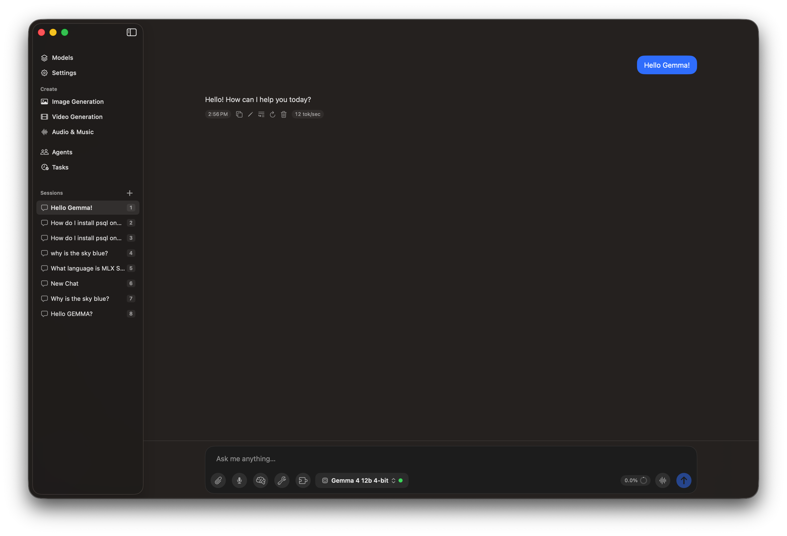
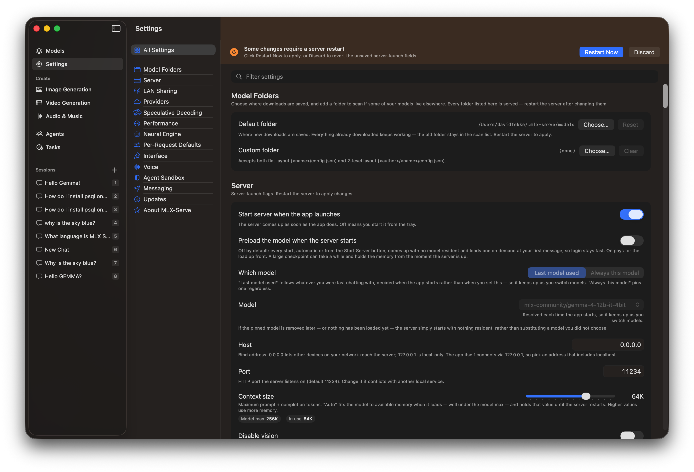
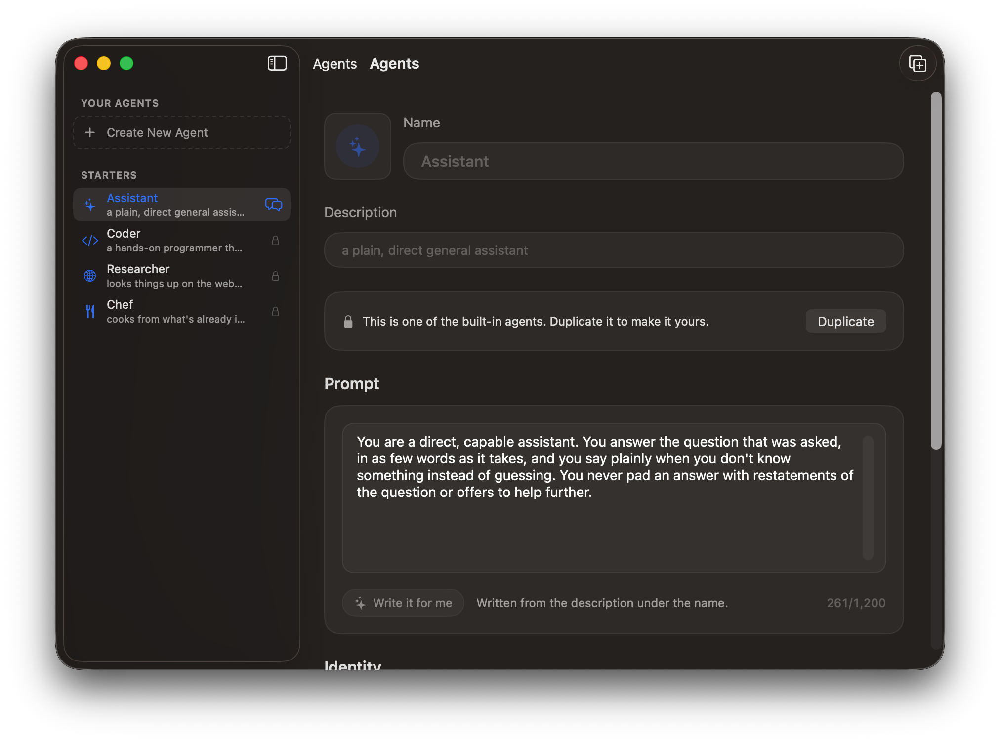
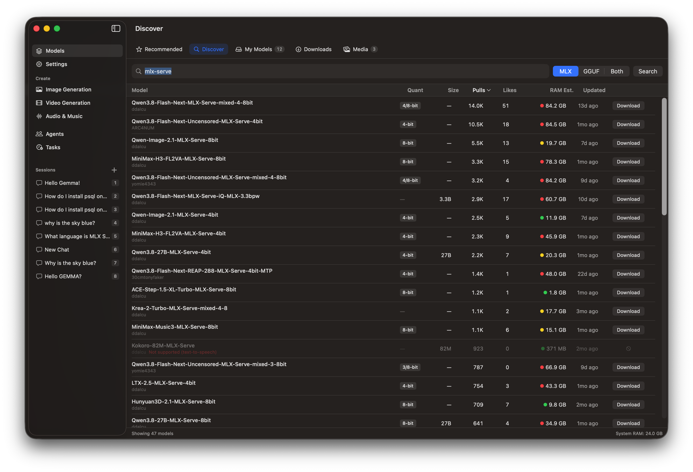

There are many complaints about AI, but one that I have been hearing more about has been the costs of running AI inference in the cloud. 
Most of the current solutions for running generative AI models involve finding a host to run the existing models because running AI usually requires very powerful computers with lots of memory and special types of processors. One of the reasons that NVidia's stock price has soared in the last couple of years is because their GPUs, or Graphic Processing Units, are really good at running the kinds of math to not only train AI models, but to serve them. Serving AI models is often referred to as AI inference. There are other types of processors that can also be used such as NPUs, LPUs and TPUs that can also be used for providing inference for these models.

One of the features of the new Apple Silicon processors is that they have multiple cores on the chip that have GPUs and NPUs. NPUs are what Apple calls Neural Processing Units. Both of these types of cores can be used for improving AI performance on Apple Hardware. This includes Apple Macintoshes as well as iOS and iPadOS devices.

I was lucky enough to see a presentation on [MLX-Serve](https://mlxserve.com/) at the last [JaxNode](https://jaxnode.com/) user group meeting. [David Dalcu](https://github.com/ddalcu), the developer behind this [open source project](https://github.com/ddalcu), showed the many incredible features of this application, and how it can be used for running local AI inference.

In his presentation he talked about some of the challenges he has faced as an AI engineer building AI agents using local inference. There are a number of other solutions for running open eight LLMs locally like Ollama, LM Studio and oMLX, but none of them have the all of the features and performance on the Apple processors.

## MLX

To understand MLX-Serve we should take a look at [MLX](https://ml-explore.github.io/mlx/build/html/index.html). MLX is an open source project sponsored by Apple research that provides a NumPy and PyTorch like framework for flexible machine learning on Apple Silicon. The framework can either be run in Python or in native languages like C++.

The key differentiator between MLX and other machine learning frameworks is that it takes advantage of the technology for accelerated computing in Apple Silicon processors.

## MLX-serve

The MLX-Serve application is built on top of the MLX framework. The application is made of two parts. One is the core of the application which is written in Zig, and the other is a SwiftUI application that provides a front end for end users.

The core application has several capabilities that make it it unique, such as the ability to run not just LLMs like GEMMA or Llama, but it can run text to speech, speech to text, music generation, video generation and drawing models. The core application includes a HTTP server which uses the same API as OpenAI's so you can use the existing frameworks for interacting with MLX-Serve.

Another killer feature is the ability to tweak different settings such adjusting the KV Cache and context window for the models. These can all be adjusted through the Server Settings in the Front end app.

## Agent capabilities

Something else that is neat about using MLX-Serve are the agent capabilities. In the chat window, you can toggle thinking, tools for searching the web and accessing local files and turning on MCP (Model Context Protocol) servers. There is also a Agent menu you can use to set a system prompt, an agent dialog where you can create different assistants and open the memory markdown file.

## Models

MLX-Serve can run MLX models, but can also run GGUF models more commonly used with tools like Ollama. You will get better performance if you use the MLX specific models. If you select the `Models` at the top of the left hand navigation, and then select the Discover tab, you can search for models directly on Hugging Face. If you type in `mlx-serve`, you can find all of the models that have been optimized for MLX-Serve.

## Conclusion

There are a number of other tools for running AI locally on the Mac, but MLX-Serve is the best in class app I have found for having total control over all of the buttons and knobs for controlling how these models run, and tweaking every bit of performance out of the models.

If you have not tried MLX-Serve, give it a look. It can be found at [mlx-serve.com](https://mlxserve.com), and you can even 
[download](https://apps.apple.com/us/app/mlx-serve/id6787603518) it on your iPhone and iPad if you are using fairly recent hardware. Give it a try.