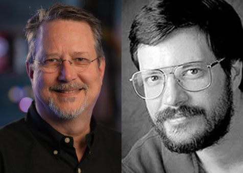
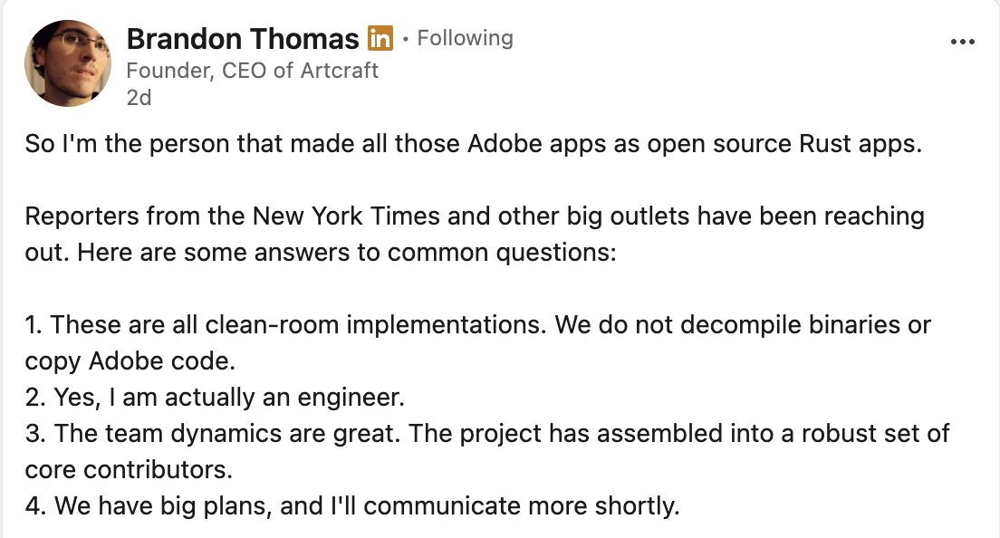

I started seeing posts and videos over the last couple of days that a company had vibe-coded open source versions of the [Adobe Creative Cloud](https://www.adobe.com/creativecloud.html), so I decided to take a look at these applications. For a frame of reference I am a software engineer and a AI Engineer. I have also been using Adobe Photoshop since version 1.0.

## A short history of Photoshop

Photoshop has a fascinating history. Before Adobe got the rights to resale the application, it was a project that Thomas Knoll was working on to help him view and process images for his PHD in computer vision. Thomas' brother John was working as a camera operator at Industrial Light & Magic, George Lucas' movie effects company.

Both John and Thomas are self taught programmers. When John Knoll saw the work his brother had been doing and started using it himself, he suggested that they turn it into a commercial project.

John went around Silicon Valley in 1987 and tried to find a software publisher who might be interested in publishing their app. [John Warnock](https://en.wikipedia.org/wiki/John_Warnock), the then CEO of Adobe saw a demo of Photoshop and got what they were doing. Adobe eventually published Photoshop in 1990, so Photoshop has been around for over 35 years. Thomas Knoll still works at Adobe, and John is now the Chief Creative Officer at ILM.

When Photoshop was originally released it was a Mac only application written in [Object Pascal and 68K assembly](https://github.com/amix/photoshop). When Photoshop 2.5 was released, they had rewritten Photoshop in C++, and ported it to Windows. To this day Photoshop is still just available on Windows and MacOS. One of the complaints about the Adobe desktop applications is that none of them are available on Linux.

Over the decades Adobe has made continuous improvements to their applications, and made sure that they can take advantage of whatever technologies are available in the CPU and GPU to get the best performance. Photoshop in particular is an important tool for photographers, pre-press and many other creative professionals. Even though I do not use Photoshop as much as I used to, I still maintain a subscription to the Adobe Creative Suite, which in the United States runs about $70 a month.

## Artcraft

I had not heard much about [Artcraft](https://getartcraft.com/) before the release of these tools, but I have learned a little in the last couple of days. Artcraft is a company that makes Generative AI tools for create professionals. They have other tools for generating images and video. They are also working on a Microsoft Office style suite of applications.

The creative app alternatives for the Creative Suite are all open source and be viewed on Github. I decided to take a look at the source code for Photocraft. All of these applications are written in Rust. They can be run from the Web, a cli, and as a desktop application on Windows, MacOS and Linux. These apps have been developed quickly with the first commit coming in the end of September. 

I spent part of this weekend comparing Photocraft to Photoshop. When I used Photoshop fulltime, I used the channels, layers and paths features extensively. These tools are used for helping creative professionals make masks for selecting portions of an image for tasks like background removal and color correction.

## The Good

For a tool that is only a couple of weeks old, there are many features that work extremely well. After playing around with the levels and curves tools, I was able to make simple color correction adjustments like I would have in Photoshop. If you are used to the menu layout used by Photoshop, this works almost exactly like it does in Adobe Photoshop.

## The Bad

There are a lot of things that do not work well in Photocraft. The paths tools does not work the same way as the paths tool in Photoshop. This is an important tool for making fine tuned selections. The selection tools do not work as well as the selection tools in Photoshop either.

Another important tool is the layers tool. The layers tool has some annoying bugs like have the full bounds of the image when working with smaller objects on the frame have effects applied to them. So if you take a selection and create a new layer, apply a drop shadow, that layer now takes up the height and width of the image.

These bugs really made Photocraft unusable for professional work. That being said, this project is only two weeks old, and it is open source, so I am sure these will fixed in a short period.

## The Ugly

In a post on Linkedin, Brandon Thomas, the CEO of Artcraft and the main committer of the Photocraft project, said the following:

So I am not a lawyer, so I will not speculate on the legality of whether this is copyright infringement or violation of the user license. I take Brandon at his word that they did not decompile any of the Adobe applications.

One of the things you can do with some of the more advanced AI tools is decompile an application, and use generative tools to create a new version, or even mod an existing version. Gamers are starting to take characters from one game, and add them to another game using these kinds of tools.

It is pretty clear that the developers of Artcraft have used and are familiar with the Adobe suite of applications. That alone could create a contractual issue. When you read the Eula for the Adobe Creative Cloud, it states the following:

> 17. No Modifications, Reverse Engineering, Artificial Intelligence/Machine Learning (AI/ML)
Section 17 means:

>  We invest in our technology and services and don’t allow you to recreate or attempt to recreate our products.

>  Our products are meant to support creativity and productivity, not to create AI training datasets.

>  Other than the reverse engineering activities and attempts to recreate our products described below, you can use Firefly and our generative AI tools to generate content for any other legal purpose.

>  Certain elements of the Services and Software constitute our (or our licensors’) confidential information. Except as expressly permitted in the Terms, you must not (and must not allow third parties to): (A) modify, port, adapt, or translate any portion of the Services or Software; (B) reverse engineer (including but not limited to monitoring or tracking the inputs and outputs flowing through a system or an application in order to recreate that system), decompile, disassemble, or otherwise attempt to discover, within any Service or Software, the source code, data representations or underlying algorithms, processes, methods, and any other portion of such Service or Software; or (C) use the Services or Software, or any content, data, output, or other information received or derived from the Services or Software, to directly or indirectly create, train, test, or otherwise improve any machine learning algorithms or artificial intelligence system, including but not limited to any architectures, models, or weights. If the laws of your jurisdiction give you the right to decompile the Services or Software to obtain information necessary to render the licensed portions of the Services or Software interoperable with other software, you must first request such information from us. We may, in our discretion, either provide such information to you or impose reasonable conditions, including a reasonable fee, on your decompilation of the Services or Software to ensure that our and our licensors’ and suppliers’ proprietary rights in the Services and Software are protected.

I would not be surprised if there are not legal challenges to what Artcraft is doing with their new suites of applications.

## Photoshop killers

Since Photoshop was launched in 1990, I have heard about Photoshop killers. A 'killer' is usually a term used for a competing application that is going to beat out another popular existing app. There have been a long list of applications that where called Photoshop killers. Here is a short list: QuarkXPosure, Gimp, Pixelmator, Affinity Photo, and Photopea. Some of these are actually good products, but they have not been able to replace Photoshop.

## Ill will towards Adobe

I spent the better part of the 90s working as a pre-press artist before moving over to web development. Even as a web developer, we still used Photoshop when creating graphics and images we used for our web applications. Some of our designers even designed whole web applications in Photoshop.

I started noticing changes with the designers I worked with about four years ago. Most of them had switched to a tool called Figma. Figma is a web based design tool you can use for designing web applications and mobile applications. Something else I noticed was that many of them despised Adobe for a number of reasons. One of the reasons was they felt Adobe and not done enough for improving the tools they use for developing design systems for those applications. Another thing they despised was the price Adobe charges to use their tools. Adobe charges $70 a month for the full Creative Cloud Pro. They also have a subscription you can use 20 apps for $55 a month. They also have a photography only bundle that includes Photoshop, Lightroom and Lightroom classic for $20 a month.

I remember when all of these Adobe products where shrink wrapped and came on floppy disks. I think Photoshop sold originally for $895 a copy. Adobe would come out with a new version of Illustrator or Photoshop every 18 months. Because of the cost, one of the things we would do at our company was wait for two versions before we upgraded to a new version to save money. Having also worked as a software engineer, one of the things software companies hate is not being able to predict their future sales. Almost every company I have worked for that has sold software has switched to a Saas model, or leasing the software. CFOs love this model because they can predict the revenue based on the number of customers they have leasing their software.

## Agentic coding

Software is becoming a commodity whether we like it or not. I personally hate the term `Vibe Coding`. I think a better term is `Agentic Coding`. A software engineer paired with agentic coding tools like Claude Code or Cursor is way more productive than without having these tools. Anthropic, which owns Bun, recently rewrote the entire runtime from Zig to Rust. It took a week and half and ran up about $165,000 in tokens to make this change. If they had not had these tools, it would have taken several software engineers a year to have accomplished the same task.

The stock values of many Saas companies has plummeted over the last year because Wall street thinks that AI will kill the moat that many of these Saas companies have with their software. While I don't see companies like Salesforce going away any time soon, they are definitely going to have a lot more competition.

## Conclusion

I am not going to be dumping my Creative Cloud subscription anytime soon. The Artcraft applications are impressive with what they have been able to achieve in a short amount of time. They have a lot of work to do if they are going to be replacements for the Adobe suite.

It is worthwhile looking at the source code for these open source alternative applications. They are written in Rust using the [egui](https://github.com/emilk/egui) framework. You can also look at the algorithms used for pixel interpolation.

It would be nice if Adobe released Linux versions of some of their apps. It would also be nice if they lowered their prices.