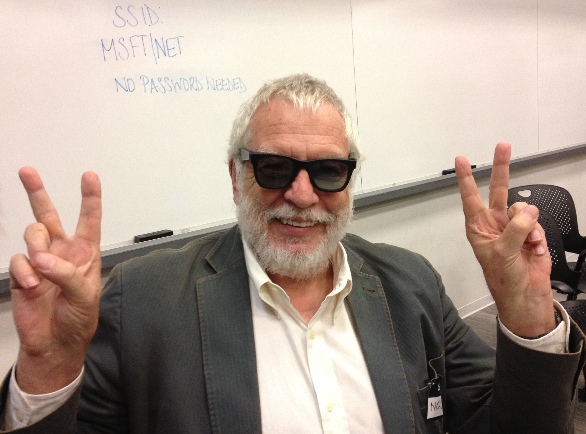
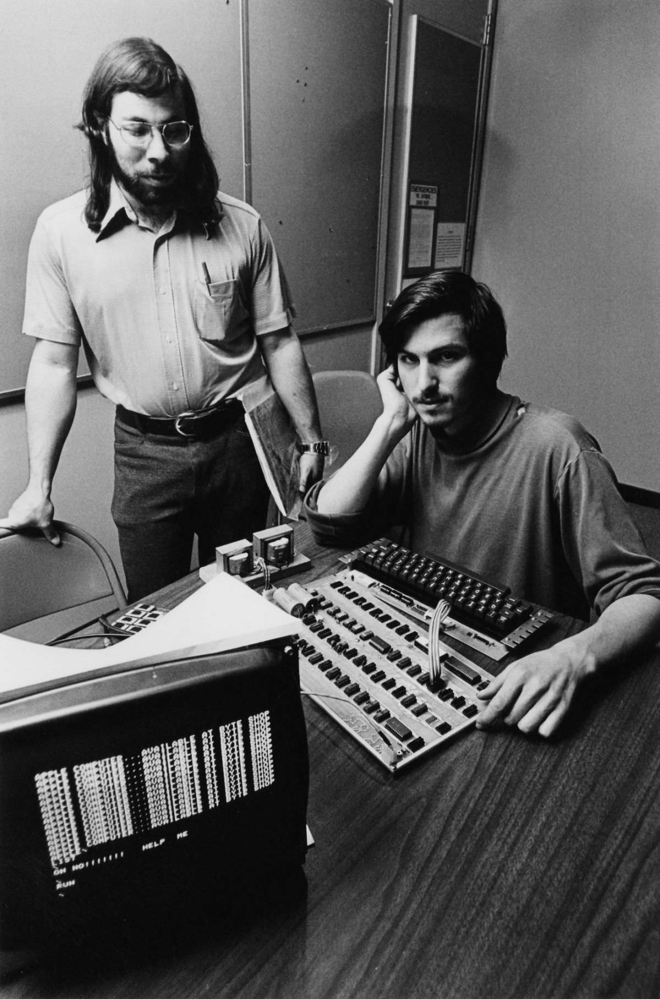

import BreakoutGame from '../../../components/BreakoutGame.astro';

## A short history of Breakout

[Atari](https://atari.com/) is one of the most admired brands in the history of technology. [Nolan Bushnell](https://en.wikipedia.org/wiki/Nolan_Bushnell) is a serial entrepreneur whose created many companies including Atari. The first hit game for Atari was [Pong](https://en.wikipedia.org/wiki/Pong). Pong is the first video game I ever played. 



Pong is a great game, but it generally needs two players to play the game. Bushnell had the idea of creating a single player version that could be used to clear blocks at the top of the screen. One of the genius ideas he had was to have a little area above the blocks where if the ball got on top, it could start to bounce and clear blocks through bouncing between the top of the screen and the block area below. 

Last week at the [JaxNode](https://jaxnode.com) user group, we had the CTO of [SpinSpire](https://spinspire.com) demonstrate [OpenCode](https://opencode.ai), an open source coding agent. One of the users in the audience, opened up his laptop and created a version of Breakout while the presentation was going on. He was able to make the game in a couple of minutes. It is far easier to make a game like Breakout today than it was 50 years ago. Even without AI assistants, you can create a game like breakout with a couple hundred lines of code.

## Developing video games in the 1970s

The main obstacle Bushnell ran against when developing video games in the 1970s was the cost of computer chips. Video games typically would have over a hundred chips on a circuit board. If you wanted to mass produce a video game board, the fewer chips the better. Lowering the cost per board increases your profit.

Bushnell told his engineers he would reward $100 for every chip removed. At this time, it was not uncommon for a video game board to have 200 chips. Also at this time Steve Jobs was an employee at Atari. Steve contacted his friend Steven "Woz" Wozniak and asked him to help him create Breakout. The story goes that Woz worked all night for four nights until he could get a prototype working. He believed it would have normally taken about six man months to create this kind of prototype.



In the end Woz was able to create a version of breakout with only 45 chips. Atari's engineers were stunned by how few chips were used in the design, but they did have to make some changes to bring it to production.
The prototype did not keep score or have sounds, something that was easily corrected after Woz had finished his prototype.

The game was programmed by just using logic circuits in the circuit design, so there was no actual software code. You could see why a simple game like this would take six months to develop.

## Steven Wozniak's observations from designing the game

Woz came away from the project with some ideas that he later used in the Apple II. Woz always tried to design his projects with as few chips as possible. This carried over in his work at Apple. While designing the game of Breakout, he starting thinking about color. The original game of Breakout was actually black and white, but Woz started thinking about how you could use simple chip logic to generate color graphics on a TV screen.

When Woz was demoing the Apple I, he decided to recreate the game in software using the integer basic he created for the Apple I and II.

```basic
10 REM BRICKWALL - ORIGINAL INTEGER BASIC GAME
20 REM PADDLE 0 MOVES THE BAT
30 DIM A$(1)
40 TEXT : CALL -936
50 PRINT "BRICKWALL"
60 PRINT "BREAK ALL 21 BRICKS. THREE BALLS."
70 PRINT "USE PADDLE 0."
80 INPUT "PRESS RETURN TO PLAY ",A$
90 S=0:L=3:B=21:D=10
100 GR
110 COLOR=5
120 VLIN 0,39 AT 0: VLIN 0,39 AT 39
130 HLIN 0,39 AT 0
140 FOR R=0 TO 2
150 COLOR=9+R*2
160 FOR C=0 TO 6
170 H=2+C*5:J=4+R*3
180 HLIN H,H+3 AT J
190 HLIN H,H+3 AT J+1
200 NEXT C
210 NEXT R
220 GOSUB 800
230 GOSUB 900
240 X=P+3:Y=35:U=RND(2)*2-1:V=-1
250 COLOR=15: PLOT X,Y
260 FOR T=1 TO 120: NEXT T
270 REM ONE FRAME
280 COLOR=0: PLOT X,Y
290 GOSUB 800
300 M=X+U:N=Y+V
310 IF M<1 THEN 350
320 IF M>38 THEN 350
330 GOTO 370
350 U=-U:M=X+U
370 IF N>0 THEN 400
380 V=1:N=Y+V
400 IF N<38 THEN 450
410 IF M<P THEN 1000
420 IF M>P+6 THEN 1000
430 V=-1:N=37:U=SGN(M-P-3)
435 IF U=0 THEN U=RND(2)*2-1
440 GOSUB 950
450 IF SCRN(M,N)>8 THEN 600
460 X=M:Y=N
470 COLOR=15: PLOT X,Y
480 FOR T=1 TO D: NEXT T
490 GOTO 270
600 REM REMOVE THE BRICK THAT WAS HIT
610 C=(M-2)/5:R=(N-4)/3
620 H=2+C*5:J=4+R*3
630 COLOR=0
640 HLIN H,H+3 AT J
650 HLIN H,H+3 AT J+1
660 S=S+(3-R)*10:B=B-1
670 V=-V
680 GOSUB 900: GOSUB 950
690 IF B=0 THEN 1100
700 REM STAY AT OLD POSITION AFTER A BRICK HIT
710 COLOR=15: PLOT X,Y
720 GOTO 270
800 REM READ PADDLE AND REDRAW BAT
810 COLOR=0: HLIN 1,38 AT 38
820 P=1+PDL(0)*31/255
830 COLOR=7: HLIN P,P+6 AT 38
840 RETURN
900 REM SCORE IN THE FOUR TEXT LINES
910 VTAB 21: TAB 1
920 PRINT "SCORE ";S;"  BALLS ";L;"   "
930 RETURN
950 REM SHORT SPEAKER BUZZ
960 FOR I=1 TO 12
970 Z=PEEK(-16336)
980 NEXT I
990 RETURN
1000 REM LOST BALL
1010 L=L-1: GOSUB 900
1020 IF L=0 THEN 1150
1030 GOTO 230
1100 VTAB 22: TAB 1
1110 PRINT "ALL BRICKS CLEARED!"
1120 GOTO 1170
1150 VTAB 22: TAB 1
1160 PRINT "GAME OVER"
1170 VTAB 23: TAB 1
1180 INPUT "PLAY AGAIN (Y/N)? ",A$
1190 IF A$="Y" THEN 90
1200 TEXT : END
```

He was able to sit down in about an hour and recreate what he had just done with circuit designs over four days by just using software. In his [autobiography](https://www.amazon.com/iWoz-Steve-Wozniak-Gina-Smith-audiobook/dp/B000LMPDMW/), Woz talks about what an "aha" moment this was for him.

## Atari could have been Apple

In various interviews Nolan Bushnell has talked about how Steve Jobs approached him to help him start a personal computer company. 
Jobs offered Bushnell a one third stake in the company. Bushnell says that he had too many things going on with Atari at the time. 
Atari was growing fast at the time, and he was not sure there was a market for personal computers. I think the investment would have been $50,000 at the time. That investment would have been worth $1.69 trillion at the time of writing this post.

## Play Breakout

If you want to see what the OpenCode version of Breakout looks like, here is that version running in a MDX component below. You can also find the source to the game [here](https://github.com/davidfekke/fek.io/blob/main/public/main.js).

Click or tap the game, then use the mouse, touch controls, or arrow keys to move the paddle.

<BreakoutGame />

## Conclusion

When Woz created the game for Atari, it gave him incite into how he could use some of the things he learned from the project in future designs, leading to the creation of color in the Apple II. The neat things about side projects like this is they sometimes lead to other lucrative ideas.

On a side note, Jobs told Woz that he would give him half of his bonus for the project. Jobs paid Woz $350, but according to some sources Jobs made a $5000 bonus by removing so many chips from game.