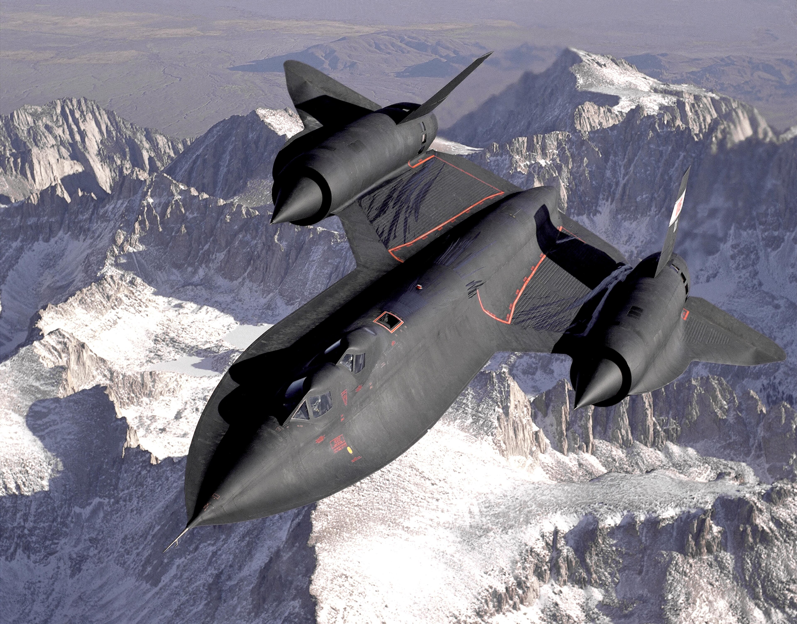
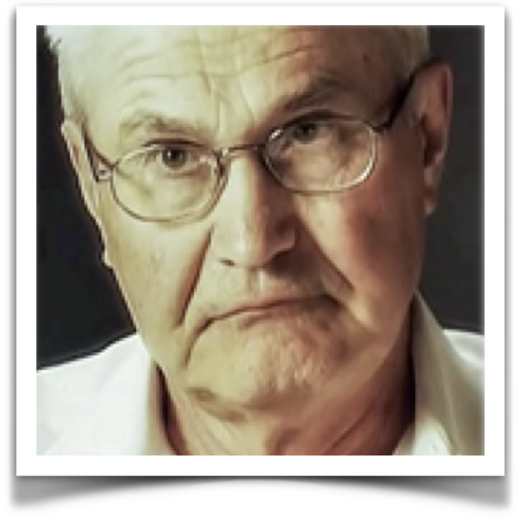
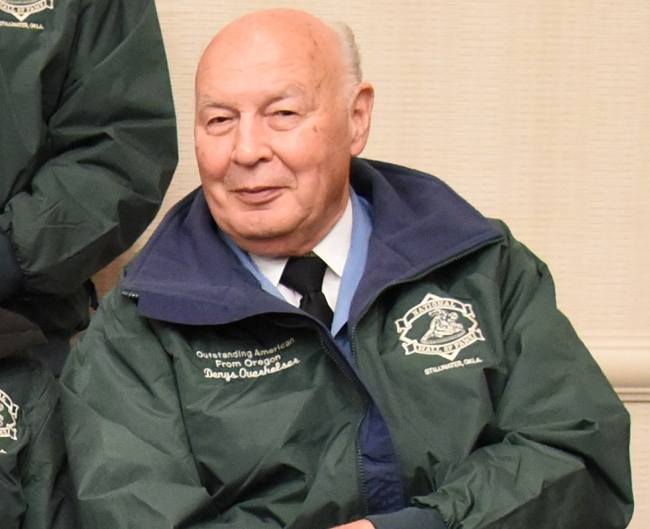
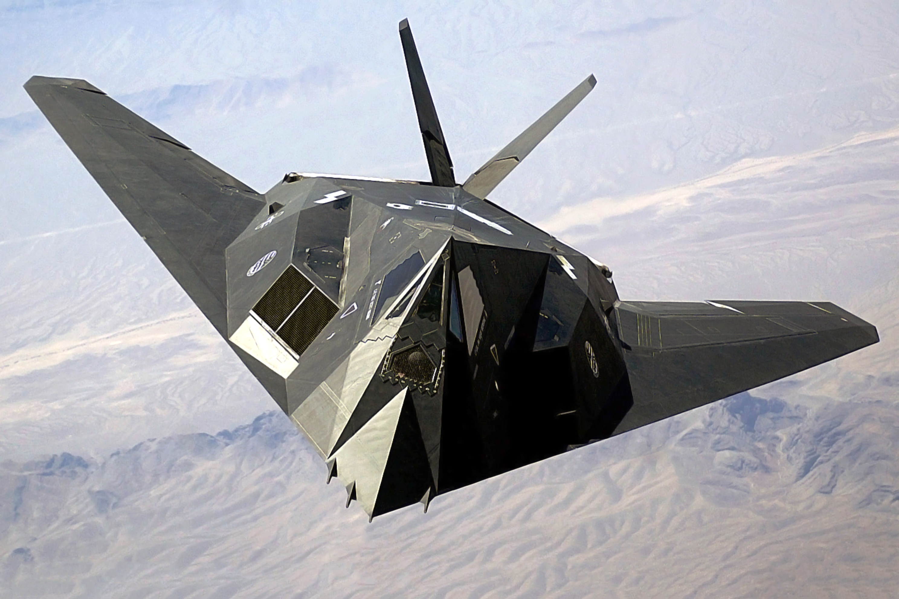
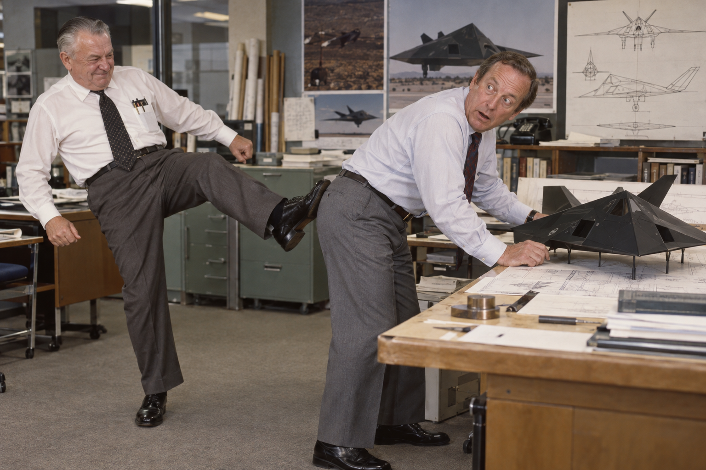

I was recently reading about software engineering principles, and one of the principles I was reading about was the KISS principle.
The KISS principle stands for Keep It Simple Stupid. I first heard this term in the autobiography from [Clarence "Kelly" Johnson](https://en.wikipedia.org/wiki/Kelly_Johnson_(engineer)).

If you are not familiar with Johnson, he was Aeronautical Engineer who started [Lockheed](https://www.lockheedmartin.com/en-us/index.html)'s [Skunk works](https://www.lockheedmartin.com/en-us/who-we-are/business-areas/aeronautics/skunkworks.html). The Skunk works designed some of the most advanced aircraft the United States ever built and flew. 
Johnson helped design the Lockheed Constellation, P-38 lightning, P-80, U-2 and SR-71. When he retired, he still came back and consulted for [Ben Rich](https://en.wikipedia.org/wiki/Ben_Rich_(engineer)) when he was designing the F-117.

## SR-71

Johnson always tried to use the KISS principle. The simpler solution is usually the easier better solution. When it came time to start building a replacement for the U-2, they wanted something that could fly so fast, it could out run missiles and bullets. They also knew that they had a limited amount of time they could use the U-2 because Soviet radar could pick up the U-2, and they would eventually find a way to shoot it down. That is why they started designing the SR-71. The only problem was there was nothing simple on the SR-71 to engineer.

The problem was that aircraft aluminum would melt at the Mach 3 speeds they wanted to fly the SR-71. Johnson's solution was a novel one, use titanium. Titanium is light for a metal, and it could withstand the hot temperatures that would occur at those supersonic cruise speeds. There were a couple of problems with trying to use titanium. Titanium is very brittle and difficult to machine. It is also harder to come by than other metals. The United States did not have large stockpiles that could have been used for manufacturing. There was one country though that had lots of titanium, Russia.

In order to acquire the titanium that Lockheed would need to build a fleet of aircraft, the CIA created third parties and dummy corporations to purchase the metal. The irony here was that Russia was selling the United States the metal they needed to build aircraft to spy on Russia.

One of the reasons why the SR-71 was impossible to use the KISS principle was that titanium is very brittle, and would break apart when they tried to machine it into the SR-71's structure. Another problem that Lockheed ran into was Air Force bureaucracy. When the U-2 was shot down over Russia, the Air Force took over the CIA's spy aircraft. The Air Force had a rule that every aircraft in the USAF had to have the Air Force logo painted on the side of the aircraft. The problem with the SR-71 was that it flew so fast, that any paint applied to it's surface would melt off. When Johnson tried to explain this to the Air Force general responsible for the program, the general told him they would have to stick to this regulation, even though the SR-71 was going to be used as a spy plane.

Lockheed had to invent a new kind of paint that would not melt off the surface of the SR-71. It cost an extra million dollars to develop the paint, but they found a way to keep the logo on the SR-71.

Johnson got so frustrated with how difficult it was to do anything on the SR-71, that he offered a $20 bill to any engineer who could find something simple to do on the SR-71. In his autobiography he said he never was able to give away that $20.

## Piotr Ufimtsev

Piotr Ufimtsev is Russian electrical engineer, mathematician and Theoretical Physicist. In the 1950s and 60s he did research how radio waves could be refracted off of surfaces. He wrote a book about his research called "Method of Edge Waves in the Physical Theory of Diffraction" in 1962. 

At this time in the Russia, if you were a scientist or engineer, and you wanted to publish your work, you had to get permission from the Soviet Union. The Soviets allowed Ufimtsev to publish his book because the felt it had no military or economic value to the USSR.

After the book was published, an engineer at Lockheed named Denys Overholser read Ufimtsev's book. After reading the book, he determined that these theories could be used to design an airplane that could be near invisible to radar. Lockheed started experimenting with different computer based designs, and wound up with a design that is very close to what wound up becoming the F-117.

Once again the irony here is that Russian research was used to design and build an airplane that could be used against the Soviet Union. The Soviets did not realize the importance of Ufimtsev's research.

## F117

One day when Johnson came back to the Skunk works, he saw the design of the F-117, he walked over to Ben Rich, and "kicked him in the ass". One of Johnson's design philosophies was that the more beautiful the aircraft, the better it flew. One of the challenges with F-117s design was that it was not aerodynamically stable. This means that it would be next to impossible for a pilot to control the aircraft.

By this time in the 1970s aircraft manufacturers were starting to use fly by wire systems that actually used a computer to fly the aircraft, with a human pilot putting their inputs through traditional controls. A human could not control the flight characteristics of the F-117, but a computer could.

## Conclusion

Even though Johnson's and Rich's work was in aeronautical design, reading their biographies is a worthwhile endeavor for any engineer. Their theories and philosophies can be used in just about any engineering discipline. Johnson's book is called [Kelly: More Than My Share of It All](https://www.amazon.com/Kelly-More-Than-Share-All/dp/0874744911/). Ben Rich's book is called [Skunk Works: A Personal Memior of My Years at Lookheed](https://www.amazon.com/Skunk-Works-Personal-Memoir-Lockheed/dp/0316743003).

There is also a great interview with Ben Rich from an interview he did with 60 minutes before he died. It well worth watching.

    

        <iframe src="https://youtube.com/embed/I9wAEjox2WI" frameborder="0" allow="accelerometer; autoplay; encrypted-media; gyroscope; picture-in-picture" class="absolute inset-0 w-full h-full border-0" allowfullscreen></iframe>
    

