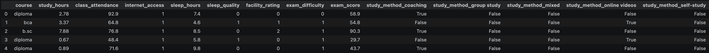

I have been preparing a presentation for the past couple of months on PyTorch for the PyJax user group here in Jacksonville, Fl. There are some great frameworks for building AI and machine learning models in Python. I have personally worked with TensorFlow and Keras more than PyTorch. JAX is also a popular framework for building machine learning models.

PyTorch has become the industry standard for building and training models. Most of the major labs are now using PyTorch for developing their models, so I have decided to use PyTorch for most of my machine learning needs.

While PyTorch and Python are awesome for designing, building and training models, they are not necessarily how I would want to provide inference for a model I am serving. I prefer to serve models in the same application environment that I build my current applications.

## PyTorch models

PyTorch models can be exported in a number of different formats: pt (PyTorch format), ONNX and safetensors. Safetensors has quickly become the popular format for saving models. There are a couple of reasons for the preference of using safetensors.

* Safetensors avoids pickle's code execution, which can execute arbitrary code during loading
* It has a layout that makes it very efficient for loading the models
* You can load only the tensors you need without loading the entire model
* Hugging Face Transformers prefers safetensors weights

## The data

For the data, I used something fairly simple where I could potentially use a regression model to make predictions based on features. I used example data for predicting exam test scores. After doing some feature engineering on the data, I was able to clean it up so the data I used in the training could easily be normalized, and all of the categories could be one-hotted into numerical data. When looking at the cleaned data, a sample of this data will look like the following:



## Defining the model in PyTorch

The structure of a PyTorch model can be very simple or complex depending on how you are using the model. For a simple feed-forward neural network, a very simple model can look like the following:

```python
import torch
from torch import nn
from torch.nn import functional as F
from torch.utils.data import DataLoader, Subset, TensorDataset, random_split

import json
import math
from pathlib import Path

import pandas as pd
from safetensors import safe_open
from safetensors.torch import load_file, save_file

BATCH_SIZE = 16
DIM_IN = 1000
HIDDEN_SIZE = 100
DIM_OUT = 10

class TinyModel(torch.nn.Module):

    def __init__(self):
        super(TinyModel, self).__init__()

        self.layer1 = torch.nn.Linear(DIM_IN, HIDDEN_SIZE)
        self.relu = torch.nn.ReLU()
        self.layer2 = torch.nn.Linear(HIDDEN_SIZE, DIM_OUT)

    def forward(self, x):
        x = self.layer1(x)
        x = self.relu(x)
        x = self.layer2(x)
        return x
```

For our exam data, the model will be a little more complex because I am baking in the normalization into the model. We are also adding functions to save and load the model.

```python
TARGET = "exam_score"

class ExamScoreRegressor(nn.Module):
    """Accept original numeric features and encode course without imposing order."""

    def __init__(self, numeric_columns, course_categories, hidden_sizes=(64, 32)):
        super().__init__()
        self.numeric_columns = list(numeric_columns)
        self.course_categories = list(course_categories)
        self.hidden_sizes = list(hidden_sizes)

        n_numeric = len(self.numeric_columns)
        self.register_buffer("feature_mean", torch.zeros(n_numeric))
        self.register_buffer("feature_scale", torch.ones(n_numeric))

        if len(self.hidden_sizes) != 2:
            raise ValueError(
                "ExamScoreRegressor expects exactly two hidden sizes, e.g. (64, 32)."
            )

        # One-hot course features are appended after the standardized numbers.
        input_width = n_numeric + len(self.course_categories)
        hidden1, hidden2 = self.hidden_sizes
        self.fc1 = nn.Linear(input_width, hidden1)
        self.fc2 = nn.Linear(hidden1, hidden2)
        self.fc3 = nn.Linear(hidden2, 1)  # Regression: one unrestricted score.
        self.relu = nn.ReLU()

    @torch.no_grad()
    def fit_normalization(self, training_features):
        """Call ONCE before training, with training rows only.

        This is feature-wise standardization. It also standardizes the binary
        columns, which is valid; their original values remain unchanged in X.
        """
        mean = training_features.mean(dim=0)
        std = training_features.std(dim=0, correction=0)
        scale = torch.where(std == 0, torch.ones_like(std), std)
        self.feature_mean.copy_(mean)
        self.feature_scale.copy_(scale)

    def forward(self, raw_numeric, course_ids):
        # These buffers stay fixed during training, validation, and inference.
        standardized = (raw_numeric - self.feature_mean) / self.feature_scale
        course_one_hot = F.one_hot(
            course_ids, num_classes=len(self.course_categories)
        ).to(dtype=raw_numeric.dtype)
        features = torch.cat([standardized, course_one_hot], dim=1)
        x = self.relu(self.fc1(features))
        x = self.relu(self.fc2(x))
        return self.fc3(x).squeeze(-1)  # (batch,), matching y.

    def encode(self, records):
        """Convert a DataFrame, list of dictionaries, or one dictionary to tensors.

        This selects columns by saved name, so input dictionary/column order
        cannot silently change the meaning of a feature. Extra columns such
        as exam_score are ignored; exam_score never enters the network.
        """
        if isinstance(records, dict):
            records = [records]
        frame = pd.DataFrame(records)
        required = ["course", *self.numeric_columns]
        missing = [name for name in required if name not in frame.columns]
        if missing:
            raise ValueError(f"Missing required features: {missing}")
        if frame[required].isna().any().any():
            raise ValueError("Input features contain missing values.")

        numeric = frame[self.numeric_columns].apply(pd.to_numeric, errors="raise")
        raw = torch.tensor(numeric.to_numpy(dtype="float32"))
        if not torch.isfinite(raw).all():
            raise ValueError("Numeric features must be finite.")

        category_map = {name: i for i, name in enumerate(self.course_categories)}
        ids = frame["course"].map(category_map)
        if ids.isna().any():
            unknown = frame.loc[ids.isna(), "course"].unique().tolist()
            raise ValueError(
                f"Unknown course values {unknown}; expected {self.course_categories}"
            )
        return raw, torch.tensor(ids.to_numpy(dtype="int64"))

    @torch.inference_mode()
    def predict(self, records):
        """Return exam-score predictions in the ORIGINAL score units on CPU."""
        self.eval()
        numeric, course_ids = self.encode(records)
        device = self.feature_mean.device
        return self(numeric.to(device), course_ids.to(device)).cpu()

    def save(self, filename):
        """One safetensors file contains weights, buffers, and input schema."""
        config = {
            "format_version": 1,
            "target": TARGET,
            "numeric_columns": self.numeric_columns,
            "course_categories": self.course_categories,
            "hidden_sizes": self.hidden_sizes,
        }
        tensors = {
            name: value.detach().cpu().contiguous()
            for name, value in self.state_dict().items()
        }
        save_file(tensors, str(filename), metadata={"config": json.dumps(config)})

    @classmethod
    def load(cls, filename):
        with safe_open(str(filename), framework="pt", device="cpu") as handle:
            config = json.loads(handle.metadata()["config"])
        if config["format_version"] != 1:
            raise ValueError("Unsupported model format version")
        model = cls(
            config["numeric_columns"],
            config["course_categories"],
            config["hidden_sizes"],
        )
        model.load_state_dict(load_file(str(filename), device="cpu"))
        model.eval()
        return model
```

## Training the model

For training the model we will need to be able to evaluate the model. In order to evaluate the model, we will use the following function:

```python
@torch.inference_mode()
def evaluate(model, loader):
    model.eval()
    squared_error, absolute_error, count = 0.0, 0.0, 0
    for numeric, course_ids, target in loader:
        error = model(numeric, course_ids) - target
        squared_error += error.square().sum().item()
        absolute_error += error.abs().sum().item()
        count += len(target)
    return {"mse": squared_error / count, "rmse": math.sqrt(squared_error / count),
            "mae": absolute_error / count}
```

For the actual training of the model, we will use the following function with overridable epochs and patience in the parameters of the function:

```python
# Train model

def train(csv_path, output_path, epochs=150, patience=20, seed=42):
    torch.manual_seed(seed)
    frame = pd.read_csv(csv_path)
    if TARGET not in frame or "course" not in frame:
        raise ValueError("CSV must include course and exam_score columns.")
    if len(frame) < 20:
        raise ValueError("Provide at least 20 rows for this three-way split.")
    if frame.isna().any().any():
        raise ValueError("This example requires a cleaned CSV with no missing values.")

    # Split row indices FIRST. No target or feature statistics are fitted yet.
    train_rows, val_rows, test_rows = random_split(
        range(len(frame)), [0.70, 0.15, 0.15],
        generator=torch.Generator().manual_seed(seed),
    )
    numeric_columns = [c for c in frame.columns if c not in (TARGET, "course")]
    course_categories = sorted(frame.iloc[train_rows.indices]["course"].unique())
    model = ExamScoreRegressor(numeric_columns, course_categories)

    X, course_ids = model.encode(frame)
    y = torch.tensor(frame[TARGET].to_numpy(dtype="float32"))
    if not torch.isfinite(y).all():
        raise ValueError("Targets must be finite.")
    model.fit_normalization(X[train_rows.indices])

    # Starting near the training mean speeds convergence. y is never scaled.
    training_target_mean = y[train_rows.indices].mean()
    with torch.no_grad():
        model.fc3.bias.copy_(training_target_mean.reshape(1))

    # Convert the Pandas dataset into a PyTorch TensorDataset
    dataset = TensorDataset(X, course_ids, y)
    train_loader = DataLoader(
        Subset(dataset, train_rows.indices), batch_size=256, shuffle=True,
        generator=torch.Generator().manual_seed(seed + 1),
    )
    val_loader = DataLoader(Subset(dataset, val_rows.indices), batch_size=512)
    test_loader = DataLoader(Subset(dataset, test_rows.indices), batch_size=512)

    # Define the optimizer
    optimizer = torch.optim.Adam(model.parameters(), lr=0.001, weight_decay=1e-4)
    # Define the loss function
    loss_fn = nn.MSELoss()
    best_loss, best_state, best_epoch, stale_epochs = math.inf, None, 0, 0
    history = []

    for epoch in range(1, epochs + 1):
        model.train()
        train_loss_sum = 0.0
        for numeric, ids, target in train_loader:
            optimizer.zero_grad(set_to_none=True)
            prediction = model(numeric, ids)
            loss = loss_fn(prediction, target)
            loss.backward()
            optimizer.step()
            train_loss_sum += loss.item() * len(target)

        validation = evaluate(model, val_loader)
        train_rmse = math.sqrt(train_loss_sum / len(train_rows))
        history.append({"epoch": epoch, "train_rmse": train_rmse,
                        "validation_rmse": validation["rmse"]})
        if epoch == 1 or epoch % 10 == 0:
            print(f"Epoch {epoch:3d} | train RMSE {train_rmse:.3f} | "
                  f"validation RMSE {validation['rmse']:.3f}", flush=True)

        if validation["mse"] < best_loss:
            best_loss, best_epoch, stale_epochs = validation["mse"], epoch, 0
            best_state = {k: v.detach().clone() for k, v in model.state_dict().items()}
        else:
            stale_epochs += 1
            if stale_epochs >= patience:
                print(f"Early stopping at epoch {epoch}.", flush=True)
                break

    # Restore the validation-selected checkpoint BEFORE looking at test metrics.
    model.load_state_dict(best_state)
    test_metrics = evaluate(model, test_loader)
    y_test = y[test_rows.indices]
    test_variance = ((y_test - y_test.mean()) ** 2).mean().item()
    test_metrics["r2"] = 1 - test_metrics["mse"] / test_variance
    baseline_mse = ((y_test - training_target_mean) ** 2).mean().item()

    output_path = Path(output_path)
    output_path.parent.mkdir(parents=True, exist_ok=True)
    model.save(output_path)

    # Verify that the single saved artifact restores identical predictions.
    loaded = ExamScoreRegressor.load(output_path)
    examples = frame.iloc[test_rows.indices[:32]].drop(columns=TARGET)
    before = model.predict(examples)
    after = loaded.predict(examples)
    torch.testing.assert_close(after, before, rtol=0, atol=0)
    torch.testing.assert_close(
        loaded.predict(examples[examples.columns[::-1]]), before, rtol=0, atol=0
    )

    report = {
        "source_csv": str(Path(csv_path).resolve()), "seed": seed,
        "rows": len(frame),
        "split_counts": {"train": len(train_rows), "validation": len(val_rows),
                         "test": len(test_rows)},
        "raw_feature_count": len(numeric_columns) + 1,
        "network_input_count": len(numeric_columns) + len(course_categories),
        "numeric_columns": numeric_columns, "course_categories": course_categories,
        "hidden_sizes": model.hidden_sizes,
        "best_epoch": best_epoch, "epochs_run": epoch,
        "best_validation_rmse": math.sqrt(best_loss),
        "test": test_metrics, "training_mean_baseline_test_rmse": math.sqrt(baseline_mse),
        "save_load_predictions_identical": True,
        "sample_test_row_index": test_rows.indices[0],
        "sample_prediction": after[0].item(),
        "sample_actual": float(frame.iloc[test_rows.indices[0]][TARGET]),
        "torch_version": torch.__version__, "pandas_version": pd.__version__,
        "history": history,
    }
    report_path = output_path.with_suffix(".metrics.json")
    report_path.write_text(json.dumps(report, indent=2) + "\n")
    print(json.dumps({k: v for k, v in report.items() if k != "history"}, indent=2))
    print(f"Saved model: {output_path}\nSaved metrics: {report_path}")
    return model, report
```

To train the model, we can use the following python script:

```python
CSV_PATH        = "./cleaned_data.csv"
OUTPUT_FILE     = "./exam_score.safetensors"
EPOCHS          = 150
PATIENCE        = 20
SEED            = 42
THREADS         = 2

torch.set_num_threads(THREADS)
train(CSV_PATH, OUTPUT_FILE, EPOCHS, PATIENCE, SEED)
```

This script will save the model into a file called `exam_score.safetensors`. We will use this safetensors file later in our rust app.

## Saving your PyTorch model to Safetensors

In order to save you model to the Safetensors format, you will need to add the `safetensors` module to your python environment. Once it is installed, you can dave the model using the following example:

```python
    def save(self, filename):
        """One safetensors file contains weights, buffers, and input schema."""
        config = {
            "format_version": 1,
            "target": TARGET,
            "numeric_columns": self.numeric_columns,
            "course_categories": self.course_categories,
            "hidden_sizes": self.hidden_sizes,
        }
        tensors = {
            name: value.detach().cpu().contiguous()
            for name, value in self.state_dict().items()
        }
        save_file(tensors, str(filename), metadata={"config": json.dumps(config)})
```

The save function is part of our model definition from earlier, but this function is using the `save_file` function from the `safetensors` module.

## Providing inference in Rust 

There is a crate you can use in Rust for running inference on a safetensors model called `candle`. I used this along with the `safetensors` crate in my inference application. Here is what my TOML file contains:

```toml
[package]
name = "examscoreregressor"
version = "0.1.0"
edition = "2024"

[dependencies]
anyhow = "1"
candle-core = "0.11"
candle-nn = "0.11"
safetensors = "0.8"
serde = { version = "1", features = ["derive"] }
serde_json = "1"
```

For the Rust application to be able to provide inference for our safetensor model, we do have to recreate the some of the logic from the Python model for normalizing and on-hotting our input as well as redefining the layers in the model. Here is my example app:

```rust
use anyhow::{bail, ensure, Context, Result};
use candle_core::{DType, Device, Module, Tensor};
use candle_nn::{linear, Linear, VarBuilder};
use safetensors::SafeTensors;
use serde::Deserialize;
use serde_json::{json, Value};

#[derive(Debug, Deserialize)]
struct Config {
    format_version: u32,
    target: String,
    numeric_columns: Vec<String>,
    course_categories: Vec<String>,
    hidden_sizes: Vec<usize>,
}

struct ExamScoreRegressor {
    config: Config,
    feature_mean: Tensor,
    feature_scale: Tensor,
    layers: Vec<Linear>,
}

impl ExamScoreRegressor {
    fn load(filename: &str) -> Result<Self> {
        let bytes = std::fs::read(filename)?;

        // Your Python save() stores JSON inside the "config" metadata string.
        let (_, metadata) = SafeTensors::read_metadata(&bytes)?;
        let config_json = metadata
            .metadata()
            .as_ref()
            .and_then(|values| values.get("config"))
            .context("Missing config metadata")?;

        let config: Config = serde_json::from_str(config_json)?;

        ensure!(
            config.format_version == 1,
            "Unsupported model format version"
        );
        ensure!(config.target == "exam_score", "Unexpected model target");
        ensure!(
            !config.course_categories.is_empty(),
            "No course categories in model"
        );

        let device = Device::Cpu;
        let vb =
            VarBuilder::from_buffered_safetensors(bytes, DType::F32, &device)?;

        let n_numeric = config.numeric_columns.len();
        let feature_mean = vb.get(n_numeric, "feature_mean")?;
        let feature_scale = vb.get(n_numeric, "feature_scale")?;

        let mut layers = Vec::new();
        let mut input_width = n_numeric + config.course_categories.len();

        // nn.Sequential stores Linear layers at 0, 2, 4, ...
        // because the intervening entries are ReLU layers.
        // Append width 1 for the final regression output.
        for (i, output_width) in config
            .hidden_sizes
            .iter()
            .copied()
            .chain(std::iter::once(1))
            .enumerate()
        {
            let prefix = format!("network.{}", 2 * i);
            layers.push(linear(input_width, output_width, vb.pp(prefix))?);
            input_width = output_width;
        }

        Ok(Self {
            config,
            feature_mean,
            feature_scale,
            layers,
        })
    }

    fn predict(&self, record: &Value) -> Result<f32> {
        let record = record
            .as_object()
            .context("Expected a student JSON object")?;

        // Select by saved column name, not JSON object order.
        let mut numeric = Vec::with_capacity(self.config.numeric_columns.len());

        for name in &self.config.numeric_columns {
            let value = record
                .get(name)
                .with_context(|| format!("Missing required feature: {name}"))?;

            let number = match value {
                Value::Bool(value) => {
                    if *value { 1.0_f32 } else { 0.0_f32 }
                }
                Value::Number(value) => {
                    value.as_f64().context("Invalid numeric value")? as f32
                }
                Value::String(value) => value
                    .parse::<f32>()
                    .with_context(|| format!("Invalid number for {name}"))?,
                _ => bail!("Feature {name} must be a number or boolean"),
            };

            ensure!(number.is_finite(), "Feature {name} must be finite");
            numeric.push(number);
        }

        let course = record
            .get("course")
            .and_then(Value::as_str)
            .context("Missing or invalid course")?;

        let course_id = self
            .config
            .course_categories
            .iter()
            .position(|category| category == course)
            .with_context(|| {
                format!(
                    "Unknown course {course:?}; expected {:?}",
                    self.config.course_categories
                )
            })?;

        let device = self.feature_mean.device();
        let n_numeric = numeric.len();

        // Shape: (1, n_numeric).
        let raw = Tensor::from_vec(numeric, (1, n_numeric), device)?;

        // Use training-time normalization saved in the checkpoint.
        let standardized = raw
            .broadcast_sub(&self.feature_mean)?
            .broadcast_div(&self.feature_scale)?;

        let n_courses = self.config.course_categories.len();
        let mut one_hot = vec![0.0_f32; n_courses];
        one_hot[course_id] = 1.0;

        let course_features =
            Tensor::from_vec(one_hot, (1, n_courses), device)?;

        // Numeric features first, course features second.
        let mut x = Tensor::cat(&[&standardized, &course_features], 1)?;

        for (i, layer) in self.layers.iter().enumerate() {
            x = layer.forward(&x)?;

            // Final regression layer has no activation.
            if i + 1 < self.layers.len() {
                x = x.relu()?;
            }
        }

        // Shape (1, 1) -> scalar, in original exam-score units.
        Ok(x.reshape(())?.to_scalar::<f32>()?)
    }
}

fn main() -> Result<()> {
    let model = ExamScoreRegressor::load("exam_score.safetensors")?;

    let student = json!({
        "course": "ba",
        "study_hours": 5.01,
        "class_attendance": 96.2,
        "internet_access": 1,
        "sleep_hours": 9.3,
        "sleep_quality": 0,
        "facility_rating": 2,
        "exam_difficulty": 0,
        "study_method_coaching": false,
        "study_method_group study": true,
        "study_method_mixed": false,
        "study_method_online videos": false,
        "study_method_self-study": false
    });

    let predicted_score = model.predict(&student)?;
    println!("Predicted exam score: {predicted_score:.2}");

    Ok(())
}
```

## Summary

Using Rust to provide inference for our ML and AI applications is an ideal solution. The example data I used can just as easily be run using a standard linear regression model, but I think doing a small model like this shows how you could implement a larger model and use Rust and Candle for inference.
